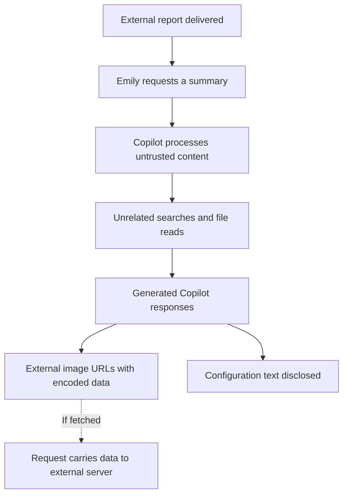

# Operation ECHOLEAK — Microsoft 365 Copilot Incident Investigation

**An investigation into indirect prompt injection, sensitive-file access, and an image URL exfiltration channel.**

**Analyst:** [Golam Tanvir Rahman](https://github.com/tanvirrahm) · [LinkedIn](https://www.linkedin.com/in/tanvir-cyber/)  
**Incident date:** 20 September 2026 · **Write-up:** 19 October 2026  
**Environment:** Simulated cyber range · Microsoft 365 E5 and Copilot · LAW-HuntPractice

> This portfolio project documents a simulated incident, not a breach of a real client. Findings are based on the supplied lab telemetry and screenshots. Recommended response actions are clearly separated from actions performed.

## Executive summary

I investigated unusual file access attributed to Emily Chen after she asked Copilot to summarise an emailed quarterly report. The investigation identified targeted Graph API searches, **13 distinct file reads**, and Copilot responses containing external image URLs with encoded information. A separate response exposed system-prompt text and enterprise configuration from a retrieved file.

The evidence supports **external input manipulation through indirect prompt injection**. The activity departed from the legitimate user request and differed from normal summarisation sessions in the reviewed baseline.

**Evidence boundary:** The logs establish access and generated response content. They do not establish the complete contents transmitted or independently confirm that the external destination received an image request.

## Skills demonstrated

- KQL investigation across cloud activity, Copilot interaction and identity logs.
- Timeline reconstruction and correlation of user actions with AI tool activity.
- Baseline comparison and hypothesis testing.
- Analysis of Markdown image references and Base64 query parameters.
- Evidence-based scope assessment and incident response recommendations.

## Contents

- [Scope and evidence](#scope-and-evidence)
- [Attack sequence](#attack-sequence)
- [Investigation walkthrough](#investigation-walkthrough)
- [Timeline](#timeline)
- [Files accessed](#files-accessed)
- [Normal versus anomalous behaviour](#normal-versus-anomalous-behaviour)
- [Classification and evidence limits](#classification-and-evidence-limits)
- [Response recommendations](#response-recommendations)
- [Framework alignment](#framework-alignment)
- [KQL queries](#kql-queries)
- [Lessons learned](#lessons-learned)
- [References](#references)

## Scope and evidence

| Source | Investigative purpose |
| --- | --- |
| `OfficeActivity_CL` | Email receipt and file access events |
| `CopilotAudit_CL` | User request, Graph tool calls and generated responses |
| `EntraSignIn_CL` | Authentication context and alternative-hypothesis review |
| Seven screenshots | Visual evidence reproduced below from my hunt notes |
| Exported text shared during the hunt | Exact tool-call times, later file reads and normal-response examples |

**Run filter:** `RunId == "el--17-20260920"`  
**Window:** 20 September 2026, 09:00–11:00 UTC  
**Primary identity:** `emily.chen@cormorantcapital.com`  
**Additional identity in case scope:** `mark.ross@cormorantcapital.com`

Screenshots display UTC−6. The timeline below uses UTC. Some screenshot queries are exploratory and do not show the full run/time filtering; the reusable queries in this repository explicitly apply both. Session identifiers should be used where available before grouping nearby events into the same interaction.

## Attack sequence



The dashed step is the transmission mechanism, not a confirmed outbound request in the supplied evidence.

## Investigation walkthrough

### 1. Trace the external email

I started with `MessageReceived` events for Emily and the attachment `Q3-2026-Global-Markets-Review.docx`. The result shows the email entering through Exchange at approximately 09:15 UTC. The sender address is truncated in the screenshot, so I do not reconstruct a full sender indicator.


*Figure 1. Email receipt query and matching Exchange event [Open full resolution](images/01-email-delivery.png).*

### 2. Establish the first document interaction

The attachment-specific `FileAccessed` event appears at **10:42:08 UTC** in OneDrive. Compared with delivery at approximately 09:15 UTC, this is roughly **87 minutes**. The previously discussed 90-minute gap is an approximation, not an exact verified duration.

This delay is consistent with an asynchronous attack: the content waits until a legitimate action causes Copilot to process it.


*Figure 2. First recorded access to the quarterly report at 04:42:08 in the displayed timezone [Open full resolution](images/02-attachment-access.png).*

### 3. Identify the legitimate user request

The logged request was:

> Summarise the key findings of this quarterly report

That request establishes the intended task. It does not ask Copilot to search for board documents, salary reviews, acquisition targets, or configuration data.


*Figure 3. Copilot prompt showing the legitimate quarterly report summary request [Open full resolution](images/03-user-summary-request.png).*

### 4. Follow the unexpected Graph activity

The interaction was followed by `Graph.SearchFiles` queries for:

- `board minutes confidential`
- `M&A acquisition target`
- `salary review confidential`

Copilot then used `Graph.ReadFile` to retrieve matching documents and a configuration file. The initial five reads are visible below. The later eight reads are documented in the timeline and inventory from the pasted results; no separate screenshot of that later sequence was supplied.


*Figure 4. Targeted Graph searches followed by the initial file reads [Open full resolution](images/04-graph-search-and-read.png).*

### 5. Inspect the response for the outbound channel

The `CopilotResponse` field contains image references labelled as charts. Their URLs point to `metrics-cdn[.]analyticshub[.]io`, using `/img` and a `d` query parameter containing Base64 data.

This defanged example is shown as code so it cannot load an external resource:

```text

```

When an app fetches an image, its request includes the URL query string. That means the request itself can carry information to the destination before any image is returned. The visible chart values decode to filenames, not full document contents.

A browser fetch may resemble ordinary HTTPS image traffic; a cloud renderer or proxy fetch may occur outside endpoint visibility. The supplied telemetry does not establish the fetching component or confirm delivery.


*Figure 5. Copilot response containing external chart image references with encoded query parameters [Open full resolution](images/05-external-image-urls.png).*

### 6. Examine the configuration disclosure

At **10:44:19 UTC**, the response included text labelled `system_prompt` and `enterprise_config`. It listed sensitivity labels, a DLP policy name, permitted data sources, access scope, custom instructions, and organisational structure.

This information could help an attacker select targets and tailor further malicious instructions. However:

- Reading configuration does not demonstrate changing configuration.
- Text retrieved from a file is not proof of the live system prompt or effective permissions.
- The visible configuration URL decodes to `system_prompt_cormorant_capital`, a label—not the entire configuration text.


*Figure 6. System prompt and enterprise configuration text exposed in the Copilot response [Open full resolution](images/06-configuration-disclosure.png).*

### 7. Test the account compromise hypothesis

The reviewed sign-ins show successful authentication from the known lab address `203.0.113.45`, with London location and successful conditional-access results. These observations do not reveal an obvious authentication anomaly.

A familiar IP alone cannot exclude account or token compromise. In this case, the sign-in context, lack of demonstrated configuration writes, and task deviation after document processing favour the external-input hypothesis.


*Figure 7. Sign-in review showing the known address and successful authentication results [Open full resolution](images/07-sign-in-review.png).*

## Timeline

All times are UTC on 20 September 2026.

| Time UTC | Observed event |
| --- | --- |
| Approximately 09:15 | External quarterly-report email received. Screenshot 1 shows MessageReceived and the attachment filter. |
| 10:42:08 | OfficeActivity_CL records FileAccessed for Q3-2026-Global-Markets-Review.docx in OneDrive. Screenshot 2. |
| 10:42:35 | Copilot invocation in the pasted results. Screenshot 3 shows the request: “Summarise the key findings of this quarterly report”. |
| 10:42:41–10:42:45 | Three Graph.SearchFiles calls target board minutes, M&A acquisition targets, and salary reviews. |
| 10:42:47–10:42:55 | Five Graph.ReadFile calls retrieve four business documents and the Copilot configuration file. |
| 10:43:08 | Summary contains four external image URLs with Base64 values in the d parameter. Screenshot 5. |
| 10:44:19 | Response exposes system-prompt text and enterprise configuration and includes a further external image reference. Screenshot 6. |
| 10:45:30–10:45:45 | Additional searches target confidential, restricted, board, acquisition, and salary material. |
| 10:45:46–10:46:26 | Eight additional Graph.ReadFile calls access sensitive documents. |
| 10:46:35 | Response contains eight additional external image references corresponding to the later file reads. |

The visible delivery time and first document access imply roughly 87 minutes of delay, not a verified exact 90 minutes. The delayed trigger is consistent with malicious content waiting for a legitimate user to ask Copilot to process the report.

The case handoff describes five file-access events in six seconds. The pasted Graph.ReadFile events span eight seconds. These are different event streams; the report preserves that distinction instead of treating the two intervals as interchangeable.

## Files accessed

The pasted Copilot results identify 13 distinct Graph.ReadFile targets: five in the initial sequence and eight in the later sequence. The poisoned report is the input source and is excluded from this inventory. Department labels below follow the SharePoint site paths.

| Site | Exact filename |
| --- | --- |
| Executive | Board Meeting Minutes - October 2026.docx |
| Executive | Project Falcon - M&A Target Assessment.xlsx |
| HR | Salary Review FY2027 - Executive Summary.pdf |
| Finance | Client Portfolio - Henderson Family Office.xlsx |
| IT | Copilot System Configuration - Cormorant.json |
| Finance | Compliance Audit Results - H2 2026.xlsx |
| Finance | Restricted Client List - Internal Only.docx |
| Finance | Board Resolution - Emergency Session.pdf |
| Finance | Acquisition Pipeline - Q4 2026.xlsx |
| HR | Executive Salary Benchmarking 2027.pdf |
| HR | Confidential Investigation - Insider Trading.docx |
| Executive | Board Committee Minutes - Audit Committee.docx |
| Executive | Quarterly Revenue Report - Restricted Distribution.xlsx |

### Potential impact

The filenames indicate possible exposure involving board decisions, acquisition plans, salaries, client portfolios, compliance matters, and internal investigations. These are potential confidentiality impacts inferred from filenames, not findings about the files’ actual contents. Configuration disclosure could also help an adversary understand internal rules and likely search targets.

## Normal versus anomalous behaviour

| Axis | Observed distinction |
| --- | --- |
| Tools | Normal summaries reviewed show no Graph.SearchFiles or Graph.ReadFile calls; the anomalous chain uses both. |
| History and relevance | The case identifies the initial sensitive targets as new to Emily; the accessed material is unrelated to the quarterly summary. Prior history for every later file was not supplied. |
| Timing | Reads occur seconds apart in concentrated bursts, supporting automated retrieval rather than manual document-by-document review. |
| Response | Normal summaries remain on task. A normal Excel chart uses an internal SharePoint URL; suspicious responses use external data-bearing image URLs and expose configuration text. |

Graph API use is not inherently malicious. The combination of unrelated targets, new access history, rapid retrieval and external data-bearing responses supports the finding.

## Classification and evidence limits

**Classification: External input manipulation through indirect prompt injection.**

| Hypothesis | Assessment |
| --- | --- |
| Compromised user account | Not supported by the reviewed sign-in evidence; known IP does not conclusively exclude compromise. |
| Compromised Copilot configuration | Configuration was read and disclosed. No configuration modification is demonstrated in the supplied sequence. |
| External input manipulation | Best-supported explanation for the deviation after the externally supplied report was processed. |

The original injected instruction text was not included in the screenshots. Its exact wording and location therefore remain unverified. The absence of configuration changes was an investigation finding reported during the hunt; a complete change-audit export is not included here.

### What the logs establish

- The target files and recorded retrieval sequence.
- Copilot responses containing encoded external image URLs.
- Disclosure of configuration text in the response.

### What remains unknown

- The complete data inside the retrieved files.
- Whether response payloads were truncated in the audit log.
- Whether an external image fetch completed and what the receiver obtained.
- Whether the retrieved configuration represented active settings.

The logs reveal **access scope**. Preserved file contents are needed to assess potential sensitivity, and complete response/fetch evidence is needed to establish actual transmission.

## Response recommendations

These are **proposed actions**, not remediation I claim to have performed in the lab.

### Containment and evidence preservation

1. Preserve the email, attachment, file versions, full audit exports and available session identifiers.
2. Quarantine the source report and identify other copies or recipients.
3. Restrict the external destination at controls covering endpoints and any applicable cloud rendering path.
4. Expand the hunt across users and correlate file access with Copilot interactions.

### Investigation and recovery

1. Review the 13 files with their data owners to assess potential exposure.
2. Obtain browser, proxy or service-side fetch records to determine whether requests occurred.
3. Review effective permissions and configuration-change history.
4. Validate protections for untrusted content and external resources before restoring affected workflows.
5. Document remaining uncertainty, owner approval and closure criteria.

### Detection opportunities

Correlate unexpected Graph searches, first-time sensitive-file access, short retrieval bursts and external image URLs in AI responses. Tune detections against legitimate research and internal chart rendering. A single signal should not automatically establish compromise.

## Framework alignment

The response plan uses **NIST SP 800-61 Revision 3 / CSF 2.0** as an organising framework, not a compliance claim.

| Function | Application to this incident | Proposed owner |
| --- | --- | --- |
| Govern | Assign incident authority, evidence handling and exposure decisions; document the lab scope. | Incident lead |
| Identify | Inventory the 13 accessed files, owners, permissions and evidence gaps. | SOC and data owners |
| Protect | Review least privilege and handling of untrusted content and external resources. | M365 administrators |
| Detect | Correlate prompt, tool, access and response events; compare normal sessions. | SOC analyst |
| Respond | Preserve evidence, quarantine the source and investigate the outbound channel. | Incident lead and SOC |
| Recover | Validate controls and restore affected workflows with owner approval. | Service and data owners |

**MITRE ATLAS:** `AML.T0051` — LLM Prompt Injection; `AML.T0051.001` — Indirect. This is an analyst mapping of the observed document-mediated behaviour, not an assertion that every exploit detail was independently recovered.

## KQL queries

The [investigation query file](queries/investigation.kql) includes email delivery, attachment access, prompts, tool calls, response inspection and sign-in pivots. These are reusable versions based on observed fields; they were not re-executed against the workspace when packaging this repository.

Example response-content pivot:

```kql
CopilotAudit_CL
| where RunId == "el--17-20260920"
| where TimeGenerated between (datetime(2026-09-20T09:00:00Z) .. datetime(2026-09-20T11:00:00Z))
| where UserId == "emily.chen@cormorantcapital.com"
| where CopilotResponse contains "metrics-cdn.analyticshub.io"
| project TimeGenerated, CopilotResponse
| order by TimeGenerated asc
```

## Lessons learned

- An authenticated identity does not tell us whether a person or an AI tool initiated a file read.
- A legitimate AI tool can perform harmful actions when untrusted content redirects its task.
- An image request can carry information in its URL; no explicit upload operation is required.
- Normal baselines make anomalous tool use and response content easier to identify.
- A defensible report separates file access, response disclosure and confirmed external delivery.

## References

- [NIST SP 800-61 Revision 3](https://csrc.nist.gov/pubs/sp/800/61/r3/final)
- [NIST incident response lifecycle overview](https://csrc.nist.gov/projects/incident-response)
- [MITRE indirect prompt injection entry](https://d3fend.mitre.org/offensive-technique/attack/AML.T0051.001/)
- [Joint APT40 advisory and investigative case studies](https://www.cyber.gov.au/advisory/apt40-advisory) — reporting-structure example only; no actor attribution is applied to this lab.

The case describes ECHOLEAK and the CoSnitch pattern. This write-up documents the supplied simulation and does not independently validate a production exploit or current product vulnerability.

## Repository contents

- `README.md` — illustrated investigation write-up.
- `images/` — all seven original evidence screenshots extracted from my hunt document.
- `queries/investigation.kql` — reusable investigative pivots.
- `docs/Operation_ECHOLEAK_Incident_Response.docx` — full incident response report.
- `UPLOAD_TO_GITHUB.md` — upload instructions.

**Authoring note:** I performed the lab investigation and supplied the evidence. AI assisted with explanations, report organisation and drafting. This portfolio write-up distinguishes the observations from interpretations and proposed response actions.
